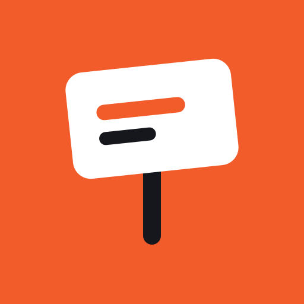
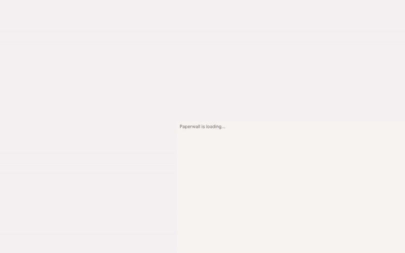

<div align="center">



# Paperwall

### Design without the paywall.

Free, offline, yours.

An open-source alternative to Canva that runs entirely on your device.
No account. No upload. No watermark. No "Pro" wall.

**[Open Paperwall](https://manoharys.github.io/paperwall/)** · [download the one-file app](https://github.com/manoharys/paperwall/releases/latest) · [scoreboard](SCOREBOARD.md)



<sub>20 seconds, recorded from the real app by <code>scripts/record-demo.mjs</code> · <a href="docs/assets/demo.mp4">MP4</a></sub>

</div>

---

Posters, social posts, invitations, menus, thumbnails and slides, made in
your browser. Paperwall is **one HTML file**: open it once and it works offline,
on a plane, forever. Your photos never leave your computer, because the page
is not allowed to send anything anywhere: its security policy blocks every
network request, and the browser enforces that.

## What's free here

All of it. Including the things other tools put behind a subscription:

- **Transparent PNGs**, and PNGs at 2x and 3x size
- **Resize a design** to another format in one click (post → story → slides)
- **A brand kit**: your colors and fonts, applied in one click
- **Vector PDF with your fonts embedded**: sharp at any size, with real, searchable text
- **Print PDF with bleed and crop marks**, ready for a print shop
- **PowerPoint (.pptx)** with editable text, shapes and pictures
- SVG with fonts inside, JPG, a flattened PDF, a zip of pages, print
- **Charts, tables, QR codes**, and removing plain backgrounds, all on your device
- **No watermark, ever**, and no account

## The scoreboard

Every feature in [`features.json`](features.json) is either **verified by an
end-to-end test in a real browser** or listed as **not done yet**. This table
is generated from the test run, never written by hand.

<!-- scoreboard:start -->
**165 of 166 features verified** by browser tests · 1 not done yet · [full scoreboard](SCOREBOARD.md)

| Area | Verified |
| --- | --- |
| Designs | 12 / 12 |
| Pages | 11 / 11 |
| Viewing | 7 / 7 |
| Selecting and moving | 13 / 13 |
| Editing | 20 / 20 |
| Text | 23 / 23 |
| Shapes and lines | 8 / 8 |
| Images | 15 / 16 |
| Graphics | 10 / 10 |
| Color | 5 / 5 |
| Brand kit | 3 / 3 |
| Templates | 9 / 9 |
| Motion | 8 / 8 |
| Export | 15 / 15 |
| The app | 6 / 6 |

Not done yet: remove an image's background on your device.
<!-- scoreboard:end -->

## Use it

- **In your browser:** [manoharys.github.io/paperwall](https://manoharys.github.io/paperwall/). Install it from the address bar to get an app that works offline.
- **As one file:** download `paperwall.html` from the [latest release](https://github.com/manoharys/paperwall/releases/latest) and double-click it. That's the whole app (about 5 MB, all 92 fonts included).
- **From source:**

  ```bash
  git clone https://github.com/manoharys/paperwall paperwall && cd paperwall
  npm run dev        # http://127.0.0.1:5173, no install needed
  npm run build      # dist/paperwall.html and the hostable site
  ```

There are no dependencies. Node 20+ runs the dev server and the build; the
end-to-end tests use Playwright.

## How it's built

- **Plain JavaScript, no framework, no dependencies.** The design model,
  edits, undo, text layout and the SVG renderer are pure functions with unit
  tests (`src/model`). The editor is a thin layer on top (`src/app`).
- **One renderer.** The page you edit and every file you download come from
  the same SVG renderer, so what you see is what you get.
- **Everything on your device.** Designs, uploads and your brand kit live in
  your browser's storage. PNG, JPG, PDF, PowerPoint and zip files are made
  in the page. There's a QR code generator, two PDF writers (vector with
  embedded font subsets, and flattened), a PowerPoint writer, a zip writer,
  deflate, a Brotli decoder and a WOFF2 font reader in here, all small,
  written from the public specs, and tested.
- **Library:** 397 templates in 44 categories (each one passes a quality
  check in a real browser: no overflow, no broken words, readable contrast),
  92 open-license font families (SIL OFL / Apache 2.0) loaded only when used,
  1,956 icons (Paperwall's own plus Lucide, ISC) and 198 stickers.

## Compared with Canva

Paperwall covers making a design on your own, start to finish, including
animated ones (GIF, MP4, WebM). It has no stock library, AI, collaboration
or cloud, and no timeline video editor. The honest,
area-by-area comparison is in [docs/PARITY.md](docs/PARITY.md).

## Contributing

Templates, icons and translations are the best place to start. See
[CONTRIBUTING.md](CONTRIBUTING.md); the clean-room rules apply to everyone.

## Clean room, on purpose

Paperwall is built from scratch. We never look at, download, decompile or
analyze another company's code, network traffic or files, and we don't copy
their templates, fonts, icons, illustrations, text or look. The rules are in
[CLEAN_ROOM.md](CLEAN_ROOM.md). Every template, icon and sticker was made for
Paperwall.


## License

[MIT](LICENSE) © 2026 Manohar. Templates, icons and stickers made for Paperwall
are dedicated to the public domain ([CC0](https://creativecommons.org/publicdomain/zero/1.0/)),
so you can use them in anything, including commercial work. Bundled fonts keep
their own open licenses ([assets/fonts/LICENSES.md](assets/fonts/LICENSES.md)).

Canva is a trademark of Canva Pty Ltd. Paperwall is an independent project and
is not affiliated with, endorsed by, or sponsored by Canva. See
[TRADEMARKS.md](TRADEMARKS.md).
